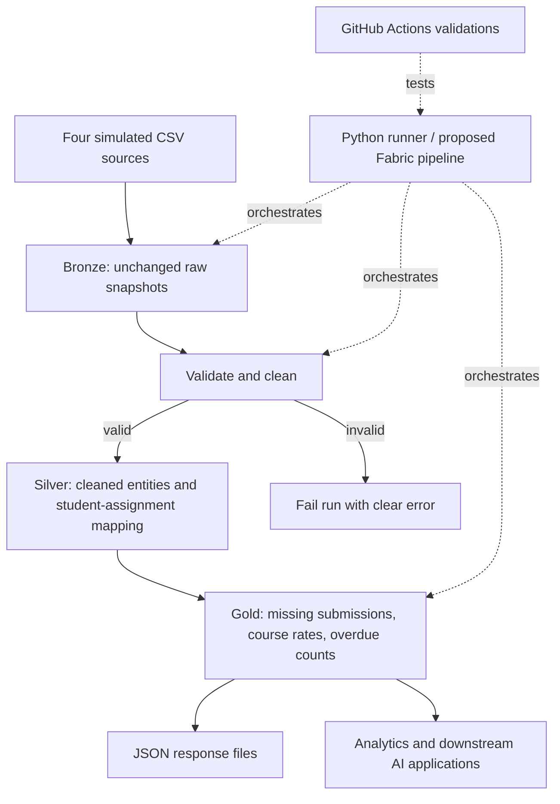

# Solution architecture
Solid labels describe local execution; Fabric mappings are the proposed cloud deployment.

| Component | Runnable local implementation | Proposed Fabric deployment |
|---|---|---|
| Sources | Four CSV files | Same CSVs in OneLake Files/source |
| Bronze | Unchanged file copies | Files/source plus bronze_* Delta tables |
| Silver | SQLite silver_* tables | silver_* Delta tables via PySpark |
| Gold | SQLite gold_* tables + CSV exports | gold_* Delta tables |
| Orchestration | run_pipeline.py | Notebook activity in Fabric Data Factory pipeline |
| Exports | outputs/*.json | OneLake Files/outputs/*.json |
| Governance | Masked SQL view, metadata JSON | Restricted Gold access, masking and catalog tags |

Local folders simulate a lakehouse; SQLite is not Delta Lake and is not claimed to be Fabric.
Fabric file copies should be retained by ingestion run in production. Current demonstration uses overwrite snapshots.
